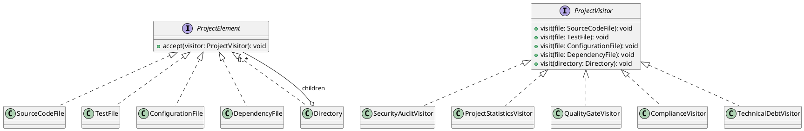
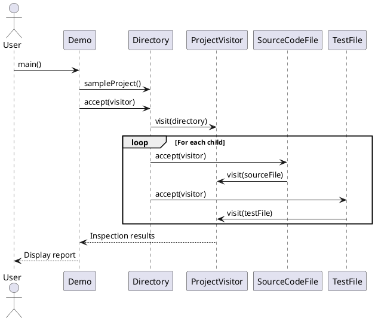

# Smart Code Inspection & Compliance Engine

## Assignment 6 — Visitor Pattern

**Course:** Design Patterns  
**Language:** Java 17  
**Build Tool:** Apache Maven  
**Testing Framework:** JUnit 5  
**Design Pattern:** Visitor Pattern  

---

## 1. Project Overview

Smart Code Inspection & Compliance Engine is a Java application that analyzes a software project using the Visitor Design Pattern.

The system performs several types of code inspections without placing inspection logic inside the project elements.

It can analyze source files, test files, configuration files, dependencies, and nested directories.

The main purpose of this project is to demonstrate the Visitor Pattern, double dispatch, separation of responsibilities, and extensible project analysis.

## 2. Technologies Used

- Java 17
- Apache Maven
- JUnit 5
- Git and GitHub
- PlantUML

## 3. Project Features

The application provides five inspection operations:

1. **Security Audit** — detects hardcoded credentials, high-risk source files, insecure configurations, and vulnerable dependencies.
2. **Project Statistics** — calculates the number of files, lines of code, tests, dependencies, and average complexity.
3. **Quality Gate** — evaluates project quality using security, complexity, and test coverage criteria.
4. **Compliance Check** — checks configuration and dependency rules and verifies whether production source files have matching tests.
5. **Technical Debt Analysis** — estimates technical debt points in the project.

## 4. Architecture

The project uses the Visitor Pattern with two main abstractions.

### ProjectElement

`ProjectElement` is the common interface for all project elements.

Concrete elements:

- `SourceCodeFile`
- `TestFile`
- `ConfigurationFile`
- `DependencyFile`
- `Directory`

Each element implements the `accept(ProjectVisitor visitor)` method.

### ProjectVisitor

`ProjectVisitor` defines overloaded `visit()` methods for every concrete element.

Concrete visitors:

- `SecurityAuditVisitor`
- `ProjectStatisticsVisitor`
- `QualityGateVisitor`
- `ComplianceVisitor`
- `TechnicalDebtVisitor`

### Double Dispatch

Each element calls the matching overloaded `visitor.visit(this)` method inside its `accept()` implementation.

This mechanism is called double dispatch because the executed operation depends on both the concrete element type and the concrete visitor implementation.

### Directory Traversal

The `Directory` class contains other `ProjectElement` objects.

Visitors recursively traverse nested directories and process their children.

This allows the system to analyze an entire project structure.

## 5. Project Structure

```text
Assignment6_SmartCodeInspection/
│
├── pom.xml
├── README.md
│
└── src/
    ├── main/
    │   └── java/
    │       └── com/
    │           └── aitu/
    │               └── inspection/
    │                   ├── ProjectElement.java
    │                   ├── ProjectVisitor.java
    │                   ├── SourceCodeFile.java
    │                   ├── TestFile.java
    │                   ├── ConfigurationFile.java
    │                   ├── DependencyFile.java
    │                   ├── Directory.java
    │                   ├── SecurityAuditVisitor.java
    │                   ├── ProjectStatisticsVisitor.java
    │                   ├── QualityGateVisitor.java
    │                   ├── ComplianceVisitor.java
    │                   ├── TechnicalDebtVisitor.java
    │                   └── Demo.java
    │
    └── test/
        └── java/
            └── com/
                └── aitu/
                    └── inspection/
                        └── Assignment6Test.java
```

## 6. How to Run the Project

### Requirements

- Java JDK 17 or higher
- Apache Maven

### Run Tests

```bash
mvn clean test
```

### Build the Project

```bash
mvn package
```

### Run the Demo

```bash
java -cp target/classes com.aitu.inspection.Demo
```

## 7. Demo Project

The `Demo.sampleProject()` method creates a sample fintech project.

Its structure includes:

```text
fintech-project/
│
├── src/
│   ├── PaymentService.java
│   └── UserService.java
│
├── tests/
│   └── PaymentServiceTest.java
│
├── config/
│   └── application.properties
│
└── pom.xml
```

The sample project intentionally contains several inspection issues:

- Hardcoded credentials.
- A high-risk source file.
- Insecure configuration.
- A vulnerable dependency.
- A production source file without a matching test.

These issues demonstrate how the visitors identify potential problems.

## 8. Assignment Questions and Answers

### 1. Why is the Visitor Pattern useful for a code inspection engine?

The Visitor Pattern separates inspection operations from the project element structure.

It allows the application to add new inspection operations without placing all inspection logic inside every element class.

### 2. How does the Visitor Pattern separate elements from operations?

Elements are represented by the `ProjectElement` hierarchy.

Operations are implemented in separate classes that implement the `ProjectVisitor` interface.

This keeps data structures and inspection logic independent.

### 3. What is double dispatch?

Double dispatch is a mechanism where the executed method depends on both the concrete element type and the concrete visitor type.

The element calls `visitor.visit(this)`, and Java selects the appropriate overloaded method.

### 4. What problems would occur if inspection logic were placed inside element classes?

Element classes would contain too many responsibilities.

Adding new inspection operations would require modifying multiple element classes.

This would make the application harder to maintain and extend.

### 5. Is it easier to add a new Visitor or a new Element?

Adding a new Visitor is easier.

A developer can create another class implementing `ProjectVisitor` without modifying existing element classes.

Adding a new Element requires adding a new `visit()` method to the visitor interface and implementing it in every concrete visitor.

### 6. When can the Visitor Pattern be a poor design choice?

Visitor may be a poor choice when element types change frequently or when the hierarchy is small and only a few operations are required.

In these situations, the additional visitor classes and methods may create unnecessary complexity.

### 7. What is the difference between Visitor and Strategy?

Strategy allows the application to select between interchangeable algorithms for a particular task.

Visitor adds different operations to a structure containing multiple element types.

Strategy focuses on selecting an algorithm, while Visitor focuses on performing operations across different object types.

### 8. Which SOLID principles are supported by the Visitor Pattern?

- **Open/Closed Principle:** New inspection operations can be added through new visitors.
- **Single Responsibility Principle:** Element classes represent project data, while visitor classes perform inspection operations.
- **Dependency Inversion Principle:** Elements use the `ProjectVisitor` abstraction instead of depending on specific inspection implementations.

### 9. What changes are needed to add a new DatabaseMigrationFile element?

The following changes are required:

1. Create the `DatabaseMigrationFile` class implementing `ProjectElement`.
2. Add `visit(DatabaseMigrationFile file)` to the `ProjectVisitor` interface.
3. Implement the `accept()` method in the new element.
4. Add the corresponding method implementation to every concrete Visitor.
5. Add tests for the new element and its visitor behavior.

Existing visitors must implement the new method before the project can compile.

## 9. Compliance Rules

The `ComplianceVisitor` collects production source files and test files during project traversal.

After all elements have been visited, the `checkTestCoverage()` method checks whether every production source file has a matching test.

In the demonstration project:

- `PaymentService.java` has a matching test: `PaymentServiceTest.java`.
- `UserService.java` has no matching test.

Therefore, the compliance result is expected to be `FAIL`.

This is a simplified demonstration rule that can be extended for a production inspection engine.

## 10. Quality Gate Criteria

The `QualityGateVisitor` evaluates the project using the following criteria:

| Criterion | Requirement |
|---|---|
| Average complexity | Less than or equal to 10 |
| Test/source ratio | At least 0.40 |
| Security issues | Zero critical security issues |

The demo project fails the Quality Gate because security issues are detected.

## 11. Unit Testing

The project uses JUnit 5 for automated testing.

The test suite contains 15 tests covering:

- Security issue detection.
- Project statistics.
- File counting.
- Lines of code calculation.
- Dependency counting.
- Average complexity.
- Quality Gate evaluation.
- Compliance validation.
- Nested directory traversal.
- Empty directory handling.
- Technical debt calculation.
- Edge cases.

### Test Results

```text
Tests run: 15
Failures: 0
Errors: 0
Skipped: 0

BUILD SUCCESS
```

All 15 tests passed successfully.

## 12. UML Diagrams

### Class Diagram

The following PlantUML diagram represents the main interfaces, concrete elements, visitors, and their relationships.



### Sequence Diagram

The following diagram demonstrates how a visitor traverses a nested project directory.



## 13. GitHub Repository

The source code is available on GitHub:

https://github.com/ame7sa/Assignment6-SmartCodeInspection

The project uses Git for version control and the `main` branch for the submitted implementation.

## 14. Conclusion

This project demonstrates how the Visitor Pattern can be used to build an extensible code inspection engine.

It separates project elements from inspection operations and uses double dispatch to execute the correct visitor method.

The application demonstrates security auditing, project statistics, quality evaluation, compliance checking, and technical debt estimation.

The implementation also includes nested directory traversal and automated JUnit 5 tests.

Overall, the project demonstrates the practical application of the Visitor Design Pattern in Java 17.