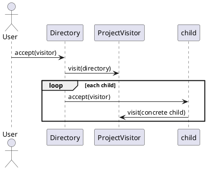

# Smart Code Inspection & Compliance Engine
## Assignment 6 — Visitor Pattern

Java 17 / Maven project implementing a code-inspection engine using Visitor and double dispatch.

### Run
```bash
mvn test
mvn package
java -cp target/classes com.aitu.inspection.Demo
```

### Architecture
- **Element:** `ProjectElement`; concrete elements are `SourceCodeFile`, `TestFile`, `ConfigurationFile`, `DependencyFile`, and `Directory`.
- **Visitor:** `ProjectVisitor`; concrete visitors: `SecurityAuditVisitor`, `ProjectStatisticsVisitor`, `QualityGateVisitor`, `ComplianceVisitor`, and `TechnicalDebtVisitor`.
- Each element implements `accept(visitor)` by calling the matching overloaded `visitor.visit(this)`. This is double dispatch: the runtime element type selects the overload, while the visitor object supplies the operation.

### Assignment questions
1. Visitor separates operations from the data structure, allowing multiple inspections without placing every operation in each element.
2. Elements are in the `ProjectElement` hierarchy; operations are in classes implementing `ProjectVisitor`.
3. Double dispatch selects behavior based on both the concrete element and concrete visitor.
4. Keeping operations in elements mixes responsibilities and makes each element grow as new operations are added.
5. Adding a Visitor is easier: add a new class implementing all visit methods. A new element requires adding a visit overload to `ProjectVisitor` and implementing it in every concrete visitor.
6. Visitor may be a poor choice when element types change frequently or the hierarchy is small and operations are few.
7. Strategy selects one interchangeable algorithm for a task; Visitor adds operations over a set of different element types.
8. Open/Closed Principle (new operations without modifying elements), Single Responsibility Principle (data elements vs operations), and Dependency Inversion (elements depend on visitor interface).
9. If `DatabaseMigrationFile` is introduced, add it to `ProjectElement`, add `visit(DatabaseMigrationFile)` to `ProjectVisitor`, implement `accept`, and update every concrete Visitor with its handling. Existing visitors will not compile until the new overload is implemented.

### Demo structure
The `Demo.sampleProject()` method builds a nested fintech project with source files, test, configuration, and Maven dependencies. All visitors traverse nested directories recursively.

### UML
Class Diagram (PlantUML):
```plantuml
@startuml
interface ProjectElement { +accept(visitor: ProjectVisitor) }
interface ProjectVisitor {
  +visit(SourceCodeFile)
  +visit(TestFile)
  +visit(ConfigurationFile)
  +visit(DependencyFile)
  +visit(Directory)
}
ProjectElement <|.. SourceCodeFile
ProjectElement <|.. TestFile
ProjectElement <|.. ConfigurationFile
ProjectElement <|.. DependencyFile
ProjectElement <|.. Directory
ProjectVisitor <|.. SecurityAuditVisitor
ProjectVisitor <|.. ProjectStatisticsVisitor
ProjectVisitor <|.. QualityGateVisitor
ProjectVisitor <|.. ComplianceVisitor
ProjectVisitor <|.. TechnicalDebtVisitor
Directory o-- "many" ProjectElement
@enduml
```

Sequence Diagram:


### Git commit plan (make at least 8 commits)
1. Initialize Maven project and README
2. Add ProjectElement and ProjectVisitor interfaces
3. Add concrete file elements
4. Add Directory composite element
5. Implement SecurityAuditVisitor
6. Implement ProjectStatisticsVisitor
7. Implement QualityGate and Compliance visitors
8. Add TechnicalDebtVisitor
9. Add tests and demo/UML documentation

**Note:** Compliance checks use a simple demonstration rule set; the source/test matching rule is illustrative and can be refined for a production engine.
